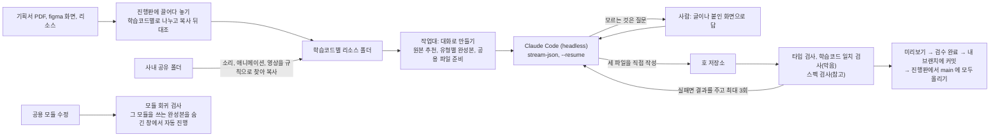
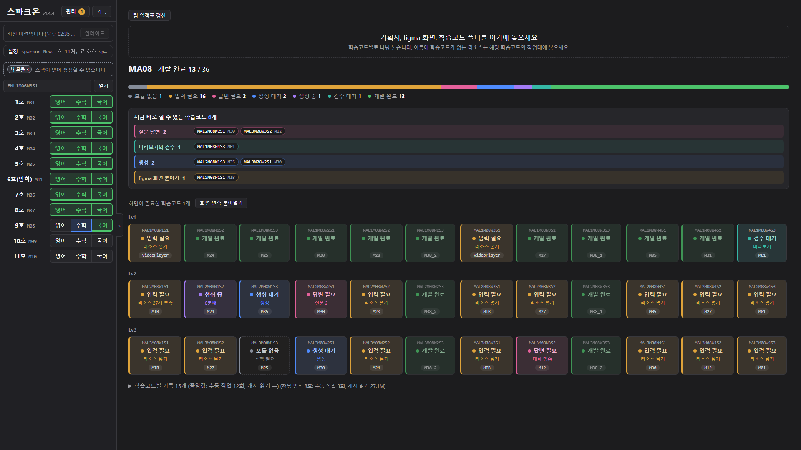
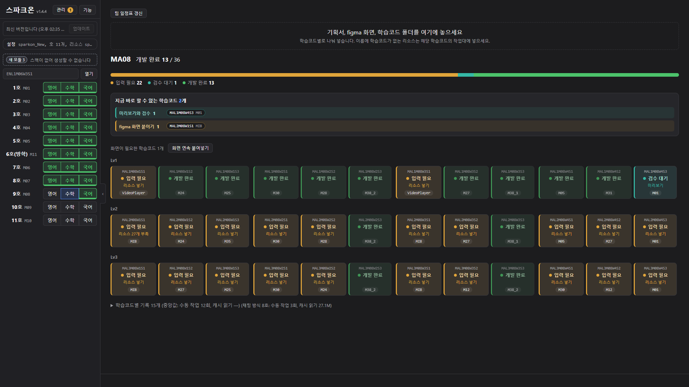
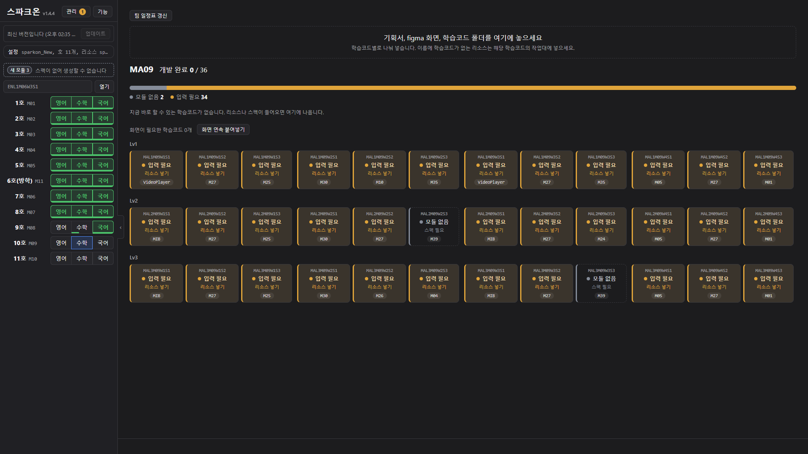
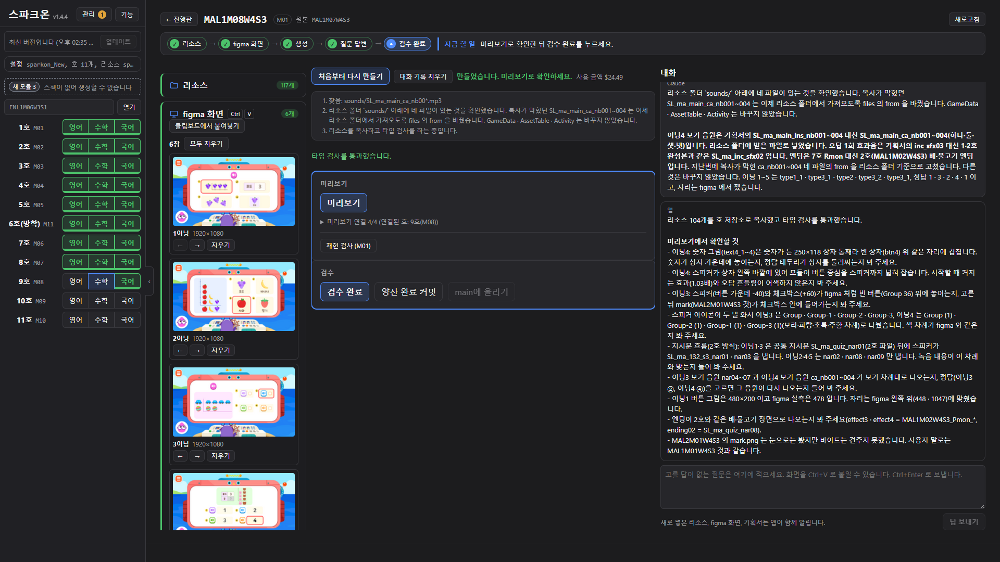
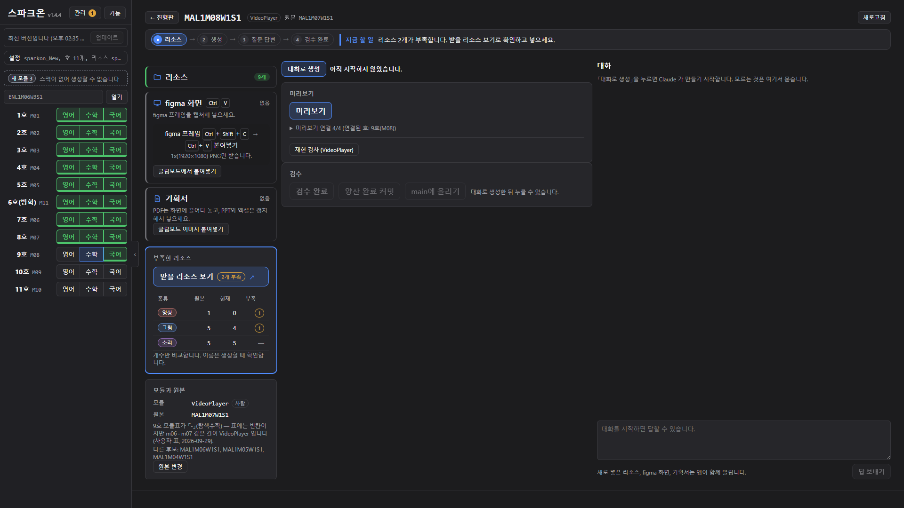
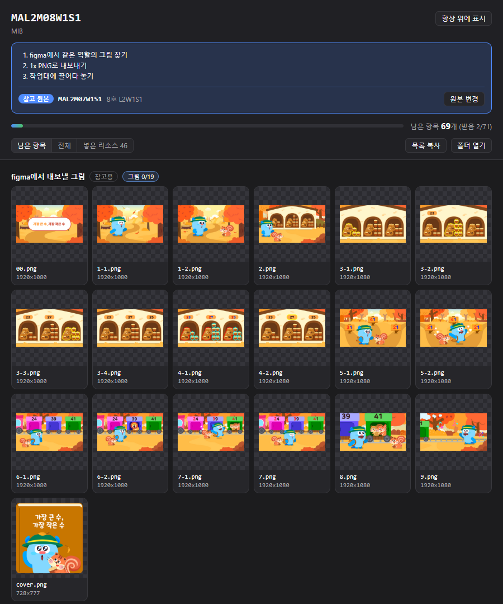
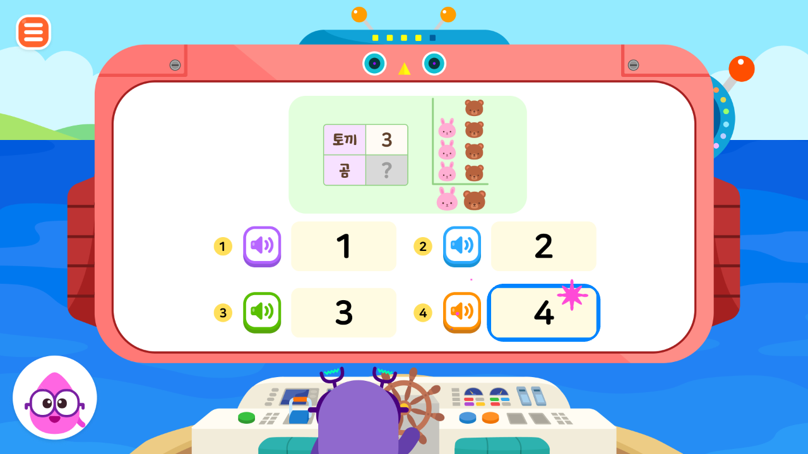
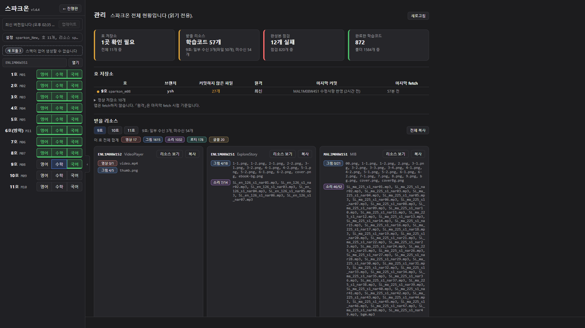
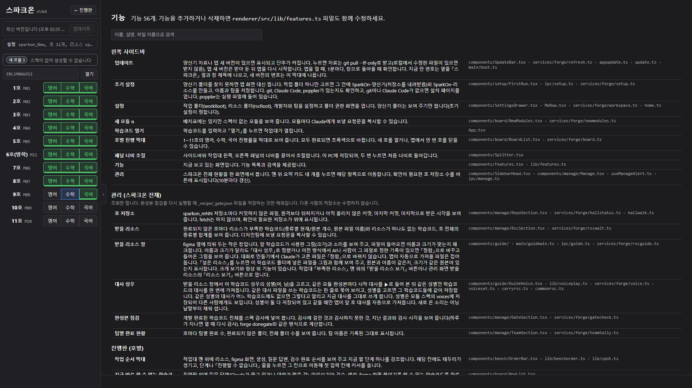

# Activity Forge — 학습 액티비티 양산 데스크톱 앱

> 에듀테크 학습 콘텐츠의 **반복 제작(「양산」)을 자동화**한 Windows 데스크톱 앱과 생성기입니다.
> 기획서(PDF), figma 화면, 디자인 리소스를 넣으면 **AI(Claude Code)가 액티비티 코드를 쓰고, 도구와 스펙이 결과를 검사**합니다.
> 혼자 개발했습니다. 기획, 설계, 구현, 배포, 사내 보급까지 맡았고, 새로 더한 누리 과목은 다른 팀이 이 앱으로 양산합니다.
> 영어, 수학, 국어, 누리 네 과목을 다룹니다(앱 1.12.0, 2026-10-28 기준).

**English summary** — An Electron + TypeScript desktop tool that automates mass production of interactive learning
activities in four subjects. Planning PDFs, figma screens and assets go in; a headless Claude Code agent writes the
activity code into the target repo. A type check, a study-code identity check and a missing-file check gate the result
and send failures back for up to three retries, while 132 JSON module specs add advisory findings. The human then
reviews, commits and merges to main from the app.
It also collects sounds, animations and videos from the in-house file share by naming rules, regression-tests shared
game modules by auto-playing finished activities in hidden windows (timers injected over CDP, 8x clock), and ships as
a single portable exe with first-run setup, a guided tour and self-update. Built solo, from design to in-house rollout;
another team now uses it for a new subject.

> **공개본 안내** — 실제 업무에 쓰는 저장소에서 회사 자료(호별 배치표, 사내 문서, 측정 도구 대부분)와
> 내부 주소, 이름을 덜어 낸 사본입니다. 모듈 스펙(`forge/_spec/`)은 들어 있습니다. 배치표와 호 저장소가 없어 실행하면 빈 결과가 나옵니다.
> 코드는 사내 저장소의 앱 1.12.0(2026-10-28) 커밋에 맞췄습니다.

---

## 왜 만들었나

학습 콘텐츠는 **학습코드(액티비티) 단위**로 만들어지고, 호마다 수십 개가 새로 나옵니다.
액티비티마다 **모듈(게임 틀) 코드는 같고** 바뀌는 것은 세 파일뿐입니다.

| 파일 | 내용 |
|---|---|
| `GameData.ts` | 이닝, 정답, 좌표, 대사 같은 값 |
| `AssetTable.ts` | 그림, 소리, 애니메이션 목록 |
| `Activity.ts` | 모듈을 불러 시작하는 입구 |

이 세 파일을 사람이 기획서와 figma 를 보며 손으로 옮겨 적었습니다. 좌표를 재고, 파일 이름을 맞추고,
앞 호에서 쓴 소리를 사내 공유 폴더에서 다시 찾아 넣는 일이 대부분이었습니다. **그 손 작업을 없애는 것**이 목표였습니다.

## 무엇을 하나



| 화면 | 기능 |
|---|---|
| **진행판** | 호와 과목마다 학습코드의 상태 일곱 가지(모듈 없음, 입력 필요, 답변 필요, 생성 대기, 생성 중, 검수 대기, 개발 완료)와 다음 할 일을 보여 줍니다. 「지금 바로 할 수 있는 학습코드」를 완료에 가까운 순서로 모읍니다. 방학호가 앞선 호의 어느 학습코드를 그대로 다시 썼는지, 어느 학습코드가 카메라나 마이크를 켜는지도 표시합니다 |
| **진행판 맨 위** | 「main 에 모두 올리기」는 공용 저장소와 호 저장소에 올릴 커밋을 먼저 보이고, 한 번 더 누르면 공용부터 차례로 main 에 올립니다. 「리소스 폴더 정리」는 끝난 학습코드의 리소스 폴더를 조건을 다시 확인한 뒤 휴지통으로 옮깁니다 |
| **끌어다 놓기** | 기획서, figma 화면, 리소스 폴더를 통째로 놓으면 학습코드별로 나눠 넣고, 복사한 뒤 원본과 대조합니다. 분류할 수 없는 파일은 사람에게 묻습니다 |
| **공유 폴더에서 가져오기** | 기획서에 적힌 소리 이름과 학습코드별 위치 규칙으로 사내 공유 폴더에서 소리, 애니메이션, 영상을 찾고, 만드는 중인 학습코드에는 저절로 복사합니다. 덮어쓰지 않고, 복사한 뒤 크기를 대조하고, 한 번 가져온 파일은 사람이 지워도 다시 가져오지 않습니다 |
| **작업대, 대화로 만들기** | 원본(같은 모듈 완성본)을 figma 화면의 배경으로 골라 주고, 모듈 안 유형마다 완성본을 열어 줍니다. Claude 가 세 파일을 쓰고, 모르는 것은 오른쪽 대화에 질문으로 남깁니다. 글이나 Ctrl+V 화면으로 답하면 같은 대화로 이어 갑니다 |
| **받을 리소스 창** | figma 옆에 띄워 두는 작은 창입니다. 앞 학습코드의 그림 크기와 소리를 보여 주고, 들어온 파일의 이름과 크기를 확인합니다. 대사 성우의 성별을 골라 같은 성별 학습코드의 대사를 한 번에 가져오고, 인터북 그림에서 더 내보내야 할 그림을 알려 줍니다 |
| **검수 완료와 커밋** | Claude 가 남긴 「미리보기에서 확인할 것」을 확인해야 검수 완료가 켜집니다. 커밋 직전에 타입 검사를 다시 하고, 그 학습코드 폴더만 커밋해 내 브랜치에 푸시합니다. main 브랜치에서는 커밋하지 않고, 남이 끝낸 학습코드는 막습니다 |
| **관리** | 호 저장소들의 커밋 안 한 파일과 뒤처짐, 받을 리소스, 완성본 전체 스펙 검사, 모듈 회귀 검사, 팀별 완료 현황을 봅니다 |
| **업데이트** | 양산기 자료(스펙, 배치표), 앱 새 버전, 공용 모듈 저장소를 한 단추로 받습니다. 대화나 올리기, 회귀 검사가 도는 중이면 자료와 공용 저장소는 받지 않고, 앱 새 버전은 받아 두기만 하고 다시 켜기를 미룹니다. 그때 앱을 끄려 하면 먼저 묻습니다 |
| **처음 설정과 둘러보기** | 실행 파일 하나를 받아 켜면 작업 폴더 하나와 이름, 팀, 브랜치 이름만 받습니다. 필요한 저장소가 있는지 점검하고, 공용 저장소와 호 저장소마다 내 브랜치를 만들고 패키지 설치와 미리보기 연결까지 합니다. 마치면 앱 안 둘러보기가 화면을 차례로 짚어 설명합니다 |

## 화면

> 사진은 앱 1.4.4(2026-10-13) 때 찍었습니다. 그 뒤 더한 기능은 위 표와 아래 글에 적었습니다.
> 사진 맨 아래 상태줄에 찍혀 있던 PC 폴더 경로는 지웠습니다.

### 진행판 — 학습코드마다 상태 색



학습코드 하나가 지금 어느 단계인지 색으로 보입니다.

| 색 | 상태 | 뜻 |
|---|---|---|
| 회색 | 모듈 없음 | 배치표가 정한 모듈의 스펙이 아직 없어 만들 수 없음 |
| 주황 | 입력 필요 | 모듈을 아직 못 정했거나, 리소스가 하나도 없거나, 기획서에 적힌 소리가 없거나, 필요한 figma 화면이 없음. 다음 할 일을 함께 적음 |
| 분홍 | 답변 필요 | Claude 가 질문을 남기고 기다리거나, 대화가 멈춤 |
| 파랑 | 생성 대기 | 입력이 다 와서 바로 만들 수 있음 |
| 보라 | 생성 중 | 대화로 만드는 중. 몇 분째인지 적음 |
| 청록 | 검수 대기 | 다 만들어서 미리보기로 확인할 차례 |
| 초록 | 개발 완료 | 검수를 마치고 저장소에 올림 |

위쪽 「지금 바로 할 수 있는 학습코드」는 질문 답변, 검수, 생성, 화면 붙이기 순서로, 완료에 가까운 것부터 모아 줍니다.
1.7.0 부터는 학습코드 위 테두리에 방학호 짝(상대 호 이름)을, 아래 테두리에 카메라와 마이크 그림을 붙입니다(사진에는 없습니다).

> 이 한 장은 일곱 가지를 한 화면에 보이려고, 실제 진행판에서 학습코드 여섯 개의 상태만 화면 안에서 바꿔 찍었습니다(파일은 그대로).
> 아래 사진은 모두 바꾸지 않고 찍은 것입니다.

| 실제 진행판 (9호 수학) | 스펙 없는 새 모듈이 섞인 호 (10호 수학) |
|---|---|
|  |  |

### 작업대 — 대화로 만들기



왼쪽에 받은 리소스와 figma 화면, 가운데에 Claude 가 한 일과 검사 결과(복사한 리소스 수, 타입 검사), 오른쪽에 대화가 있습니다.
Claude 가 모르는 것을 물으면 오른쪽에 질문이 뜨고, 글이나 붙인 화면으로 답하면 같은 대화로 이어 갑니다.
위쪽 막대는 리소스, figma 화면, 생성, 질문 답변, 검수 완료 가운데 지금 할 단계 하나를 강조합니다.

| 입력이 모자란 학습코드 | 받을 리소스 창 |
|---|---|
|  |  |
| 사진은 원본과 개수를 비교해 모자란 수를 보이던 때입니다. 다 넣은 완성본 835개로 재 보니 짝의 49%에서 「부족」이 떠서, 1.4.7 부터는 기획서 녹음 표에 적힌 소리 이름 가운데 없는 것만 「없음」으로 세고, 그림과 로티는 같은 모듈 완성본이 쓴 수의 범위만 참고로 보입니다. | figma 옆에 띄워 두는 창입니다. 원본 학습코드의 그림을 크기와 함께 보여 줘 디자이너가 같은 역할의 그림을 찾아 내보내게 합니다. 이 창에서 넣은 리소스와 원본의 짝을 확인하고 대사 성우도 고릅니다. 1.12.0 부터는 맨 위 할 일 목록이 직접 넣을 것과 앱이 가져오는 것, 다 넣었는지를 한 줄씩 알립니다. |

### 미리보기 — 만든 액티비티를 앱 안 창으로



대화로 만든 학습코드를 그 자리에서 16:9 창으로 띄워 봅니다. 창에서 난 콘솔 오류(없는 리소스 이름 등)는 작업대에 모아 보여 줍니다.
이 학습코드의 선택, 정답, 오답 테두리는 그림 파일 없이 모듈이 그린 것입니다.

| 관리 | 기능 목록 |
|---|---|
|  |  |
| 호 저장소마다 커밋 안 한 파일과 원격과의 차이, 호별 받을 리소스, 완성본 전체 스펙 검사 결과를 한 화면에서 봅니다. 사진 뒤에 「모듈 회귀 검사」가 더해져 요약 카드가 다섯 장이 되었습니다. | 앱의 기능을 한 줄씩 적고, 기능마다 어느 파일이 맡는지 함께 보여 줍니다. 기능을 더하거나 걷으면 이 목록도 같은 커밋에서 고칩니다. 사진은 56줄이던 때이고, 1.10.0 에는 81줄(걷어 낸 기능의 기록 2줄과 「자동화하기 어려운 것」 7줄 포함)입니다. |

## 기술 스택

- **앱**: Electron 44, electron-vite 5, Vite 7, React 19, TypeScript 7 (yarn)
- **생성기(forge)**: Node, ts-node, TypeScript. 실행에 필요한 외부 패키지 없이 개발 도구만 씁니다. 로그인도 DB 도 없이 앱이 그대로 불러 씁니다
- **AI**: Claude Code CLI 를 headless 로(`claude -p --output-format stream-json`, `--resume`)
- **자동 진행**: Chrome DevTools Protocol(Electron `webContents.debugger`)로 숨긴 창의 페이지를 움직입니다
- **배포**: electron-builder 의 portable 실행 파일 하나, 원격 git 브랜치로 앱 새 버전 받기
- **그 밖**: PowerShell(ACL, 레지스트리), git(셸 없이 호출), poppler(기획서 PDF 렌더링, 실행 파일에 동봉)

## 설계에서 신경 쓴 것

### 1. AI 는 만들고, 도구가 검사한다
- 모듈마다 **JSON 스펙(133장)** 을 둡니다. 항목의 형식, 반드시 있어야 할 리소스 이름(`fixedAlias`), 항목 사이 관계를 적습니다.
- AI 가 쓴 결과는 **타입 검사와 학습코드 일치 검사로 막고**, 실패하면 오류를 그대로 돌려주며 **최대 3번** 다시 맡깁니다.
  학습코드 일치 검사는 원본에서 가져온 다른 학습코드 이름이 남으면 화면은 멀쩡한데 학습 기록이 다른 곳으로 가기 때문에 넣었습니다. 개발 완료 881개 가운데 5개가 그렇게 되어 있었습니다.
- 스펙 자체도 검사합니다. `check:spec`(형식, 왕복, import, 완성본 값을 스펙이 담는지), `check:repro`(완성본을 스펙으로 다시 만들어 글자까지 같은지),
  `check:odd`(같은 모듈 완성본 가운데 혼자만 다른 값). 개발 완료 액티비티 전체를 스펙 검사에 다시 넣는 점검도 있습니다(2026-10-22: **929개** 가운데 통과 885, 결함 9, 검사 못 함 35).
  결함 9개는 모두 완성본이 AssetTable 에 없는 리소스 이름을 부르던 것이었고, 검사 못 함 35개는 스펙이 아직 없는 모듈을 쓰는 것 6개와 쓰는 모듈을 읽지 못한 것 29개입니다.
- 다른 팀이 공용 모듈을 고치면 스펙은 그 사실을 모릅니다. 실제로 10호 학습코드 하나가 열흘 동안 스펙 검사에 막혔습니다.
  그래서 스펙마다 기준으로 삼은 모듈 커밋을 적어 두고, 그 뒤 모듈에 커밋이 생기면 스펙 검사와 관리 화면이 알립니다(2026-10-22 점검에서 18개).
  처음 적은 기준 커밋은 스펙 파일 날짜로 어림한 값이고, 실제로 모듈과 맞춰 본 것은 132장 가운데 15장입니다.
- figma 화면이 필요한 모듈인데 화면이 없으면 시작 전에 한 번 더 확인받습니다. 그때 Claude 는 이닝 수와 차례를 기획서로 정하고, 어림한 좌표를 「미리보기에서 확인할 것」에 모두 적어야 합니다.

### 2. 헤드리스 AI 를 안전하게 붙이기
- 쓰기는 **작업 폴더 안만** 허용하고 셸은 주지 않습니다. 허용 규칙을 인자로 묶어 둡니다(`aisession.ts`, `aisessionio.ts`).
- 로그인이 풀렸거나, `claude` 명령을 못 찾았거나, 한 차례가 시간 상한을 넘기면 사람이 읽을 문장으로 알립니다. 대화마다 쓴 금액은 기록에 남깁니다.
  부르기 직전에 금액 상한을 보는 장치(`aitally.ts`)는 이전 생성 방식에만 걸려 있고, 대화로 만들기에는 걸려 있지 않습니다.
- 진행은 한 줄씩 화면에 보이고, 「멈추기」는 AI 차례 사이(검사 중)에도 먹습니다. 같은 학습코드는 한 번에 대화 하나만 돕니다.
- 대화, 올리기, 회귀 검사가 도는 중에 앱을 끄면 하던 일을 보이고 먼저 묻습니다. 업데이트 뒤 다시 켜기도 그 일이 끝날 때까지 미룹니다.
- 이전 생성 방식(좁은 물음을 여러 단계로 잇던 방식, 2026-10-08 에 앱에서 걷음)에서는 **녹음과 재생(`tape.ts`)** 으로 AI 의 물음과 답을 녹음해 두고
  AI 없이 파이프라인만 다시 돌렸습니다. AI 가 매번 다르게 답해도 **도구가 망가졌는지만** 따로 잴 수 있게 하려는 것이었습니다.

### 3. 모듈 회귀 검사 — 고친 공용 모듈을 완성본으로 다시 돌려 보기
공용 모듈을 고치면 어느 완성본이 깨지는지 알 길이 없었습니다. 관리 화면의 「모듈 회귀 검사」는 고친 모듈을 쓰는 개발 완료 학습코드를
과목과 상관없이 모두 골라, 보이지 않는 창에서 세 개씩 실행합니다.

- **대상 고르기**: 공용 저장소의 커밋 안 한 변경과 main 에 없는 커밋에서 고친 모듈을 찾고, 그 모듈을 import 하는 완성본을 소스에서 찾습니다.
  진행판의 학습코드 목록으로 찾으면 다른 과목 모듈을 가져다 쓴 완성본을 놓쳤기 때문입니다.
- **숨긴 창**: 창을 보이지 않게 띄우고, 창째 음소거하고, 권한 요청을 거절하고, 따로 쓰는 세션으로 엽니다.
  사람이 보는 미리보기 서버와 연결은 건드리지 않도록 호마다 다른 포트로 vite 를 따로 띄웁니다.
- **시간**: 숨긴 창에서는 requestAnimationFrame 이 초당 1번만 돌아 학습코드 하나에 342초가 걸렸습니다.
  CDP 로 페이지 스크립트보다 먼저 rAF 타이머와 8배 빠른 시계를 넣었습니다.
- **멈춤 대비**: 평가마다 시간 상한을 두고, 페이지가 15초 동안 응답하지 않으면 그 렌더러를 내리고 「못 감」으로 적은 뒤 다음으로 넘어갑니다.
- **자동 진행**: 자동 진행을 짠 모듈 다섯 개는 끝 화면까지, 나머지는 첫 이닝까지 확인하고 요약에 그 수를 따로 적습니다.
  결과는 학습코드마다 지나간 이닝 수, 콘솔 오류, 404, 걸린 시간으로 남깁니다.
- **확인**: 한 모듈의 완성본 17개가 끝 화면까지 갔고, 일부러 멈춤, 대화상자, 응답하지 않는 창을 넣어도 나머지가 끝까지 가고 창과 렌더러가 남지 않았습니다(2026-10-15).

### 4. 사내 공유 폴더에서 리소스 가져오기
- 사내 공유 폴더에 올라온 소리, 애니메이션, 영상을 사람이 학습코드마다 찾아 넣고 있었습니다.
- 위치 규칙은 과목마다 한 파일에만 둡니다(`sharerule.ts`, `shareruleen.ts`, `sharerulenu.ts`). 공유 폴더의 「N호」 폴더가 실제로는 호가 아니라
  내부 회차 번호였던 것처럼, 규칙이 흩어지면 한 곳만 고쳐지기 쉬워서입니다.
- 가져올 소리 이름은 기획서 PDF 의 녹음 표에서 이 학습코드에 해당하는 것을 읽어 정합니다. 한 PDF 에 다른 시트의 소리 이름이 섞여 오므로,
  다른 학습코드의 이름은 누적 주가 이 학습코드보다 늦지 않고, 「기존」이나 「재사용」이 적혔거나 같은 레벨인 것만 받습니다.
- 폴더 훑기는 비동기로, 시간과 개수 상한을 두고 합니다. 먼저 445 포트로 닿는지 보고, 못 닿으면 정한 문장으로 알립니다.
- 복사는 덮어쓰지 않고, 복사한 뒤 크기를 대조합니다. 저절로 가져온 기록을 남겨 사람이 지운 파일은 다시 가져오지 않습니다.
- **확인**: 이미 개발 완료한 완성본을 정답지로 두고 두 방향으로 쟀습니다.
  - 앱이 고른 것이 맞았나: 9호와 8호 학습코드 66개에서 고른 602개 가운데 582개가 완성본 파일과 이름, 크기까지 같았습니다(2026-10-15, 앱 1.5.0).
  - 빠뜨린 것은 얼마인가: 완성본 파일 가운데 같은 내용이 공유 폴더에 있는 것을 정답으로 두고, 앱이 그 파일을 공유 폴더에서 골랐는지 셌습니다.
    규칙을 고친 1.10.0 에서 국어 58.0% → 61.8%, 수학 45.7% → 66.9%, 영어 38.5% → 50.4%, 누리 0개 → 34개(62개 가운데)가 되었습니다.
    앞 호 완성본에서 가져온 파일은 이 수에 들어가지 않습니다.

### 5. 계층으로 나눈 메인 프로세스
- `ipc/`(얇은 어댑터, 로직 없음), `services/`(도메인, **Electron 을 import 하지 않음**, Node 로 단독 실행해 확인), `lib/`(범용)로 나눕니다.
- IPC 채널 이름은 `shared/ipc.ts` 상수 한 곳에 둡니다. main 과 preload 가 갈라지면 컴파일에서 걸립니다.
- 렌더러 입력 검증(신뢰 경계)은 IPC 진입점 한 곳에서만 합니다. 오류는 throw 대신 결과 객체로 돌려 화면이 멈추지 않게 합니다.
- `contextIsolation`, `sandbox` 를 유지하고 `nodeIntegration` 은 쓰지 않습니다.
- 생성기(forge)는 **`runtime.ts` 한 곳으로만** 불러 씁니다. forge 는 import 순간 환경변수로 뿌리 폴더를 정하므로,
  환경변수를 심고 동적 import 한 뒤 **심은 값이 먹었는지까지 확인**합니다(안 그러면 조용히 빈 결과가 나옵니다).
- 과목 목록은 생성기의 표 한 곳에 둡니다. 전에는 열한 파일에 따로 적혀 있어 한 곳만 빠져도 새 과목만 빈 결과가 나올 수 있었습니다.
  화면 쪽 사본과 갈라지면 타입 검사가 막습니다(`SubjectsTie`). 누리 과목을 더한 뒤 영어, 수학, 국어 진행판 33개의 출력이 전과 바이트까지 같은지 확인했습니다.

### 6. 실행 파일 하나로 배포하고 스스로 업데이트
- 받는 사람은 설치 없는 실행 파일 하나(electron-builder portable)를 받습니다. 기획서를 읽는 poppler 도 들어 있습니다.
  빌드 결과 검사(`check:build`)를 통과해야 실행 파일과 앱 새 버전이 만들어집니다. 번들에 함수가 두 벌 묶이거나 대입이 빠진 채로 나간 적이 있어서입니다.
- 처음 켜면 「초기 설정」이 작업 폴더 하나와 이름, 팀, 브랜치 이름만 받습니다. 필요한 저장소가 있는지 점검표로 보이고(앱은 저장소를 대신 받지 않고 받을 명령을 복사해 줍니다),
  「설정 완료」를 누르면 양산기 저장소 받기, 사내 CLI 준비, 공용 저장소와 호 저장소마다 내 브랜치 만들기, 패키지 설치, 미리보기 연결을 차례로 합니다. 이미 된 것은 건너뛰므로 다시 눌러도 결과가 같습니다.
- main 에 남은 저장소가 있으면 설정을 마치지 않습니다. 그대로 두면 「양산 완료 커밋」이 main 으로 바로 올라가기 때문입니다. 커밋 단추도 main 브랜치에서는 멈춥니다.
- 설정을 마치면 앱 안 둘러보기가 한 번 저절로 시작합니다. 둘러보는 동안은 창 전체의 키 입력, 붙여넣기, 끌어 놓기를 막아 아무것도 만들거나 올리지 않습니다.
- 앱 새 버전은 빌드한 `out/` 을 원격의 별도 브랜치(`app-dist`)에 커밋 하나로 올리고, 앱이 그것을 받아 사용자 데이터 폴더에 풉니다.
  시작점(`boot.ts`)은 **실행 파일에 든 버전과 받은 버전 가운데 늦게 빌드한 쪽**을 열고, 깨졌으면 든 것으로 돌아갑니다. Electron 자체와 poppler 가 바뀔 때만 새 실행 파일이 필요합니다.
- 「업데이트」 단추 하나가 자료(스펙, 배치표), 앱 새 버전, 공용 모듈 저장소를 같이 받습니다. 자료는 `git pull --ff-only` 로 받고,
  고친 파일이 스펙과 배치표뿐이면 그대로 받고, 받을 커밋이 그 파일을 건드릴 때만 잠시 치워 두고 받은 뒤 다시 적용합니다(이 처리가 없을 때는 작업대를 한 번 쓴 PC 가 업데이트를 영영 못 받았습니다).
  공용 저장소는 내 커밋이 있으면 「main 동기화」 커밋으로 합치고, 충돌하면 받지 않고 그 파일을 보여 줍니다.
- 「main 에 모두 올리기」는 저장소마다 받기, fast-forward, 합치기, 커밋, 브랜치 푸시를 차례로 하고, 다시 받아 main 이 그대로일 때만 main 에 올립니다. 강제 푸시는 하지 않습니다.

### 7. figma 화면을 읽는 도구
- 붙여넣은 화면이 **1x 크기인지 판정**하고, 같은 화면을 두 번 붙이면 받지 않습니다. 붙인 차례가 이닝 차례입니다.
- 리소스 그림을 figma 화면에서 찾는 이미지 매칭(`gen/imgfind`)을 만들었습니다. 겹치는 영역을 칠해 가리고 찾는 방법 등을 씁니다.
  지금은 아래 원본 고르기에서 배경을 찾는 데 씁니다. 이 매칭으로 좌표를 뽑던 기능(`gen/placefind`)은 이전 생성 방식과 함께 2026-10-08 에 앱에서 걷었습니다.
- 원본 고르기: 대화를 시작할 때 원본 후보마다 배경(화면 절반 넘게 덮는 그림)을 figma 화면에서 찾습니다.
  단추나 문제 그림까지 비교하면 맞은 원본을 뒤집어서 배경만 봅니다. 사람이 정한 원본은 바꾸지 않고 알리기만 합니다.
- 인터북(누르며 읽는 그림책) 그림: figma 는 누를 위치에 별을 그린 채로만 내보냅니다. 같은 배경 그림끼리 짝을 지어 다른 영역을 재고,
  별과 누른 뒤 효과를 찾아 아직 없는 그림(별을 숨긴 그림 등)을 목록으로 알려 줍니다. 9호 그림으로 낸 목록 7장이 손으로 정리한 것과 같았습니다.

### 8. Windows 현실
- 쓰기 권한은 `fs.access(W_OK)` 가 ACL 을 안 보므로 **PowerShell 로 ACL 을 읽어 병합하고 계산**합니다.
- 한글 `.ps1` 은 UTF-8 BOM, `.bat` 주석은 ASCII 로 씁니다. 인코딩 때문에 경로가 조용히 깨진 경험에서 나온 규칙입니다.
- 지우기는 **휴지통으로만** 합니다. 옮기거나 지우기 전에는 양쪽 파일 수와 용량을 대조합니다.
- 경로 대소문자가 실제와 다르면 메인 코드가 두 벌 묶이는 문제가 있어, 빌드 경로를 `realpathSync.native` 로 정합니다.
- 호 저장소의 vite 는 쓰는 중인 파일 하나의 감시 오류(EBUSY)에 서버째 죽고도 화면은 「실행 중」이었습니다. 공용 코드는 고치지 않고 앱이 띄우는 vite 에만 설정을 덧붙여 막고, 꺼지면 알립니다.
- git 과 Claude Code 를 PATH 밖에서도 찾도록 레지스트리의 PATH 와 기본 설치 위치를 뒤에 붙여 찾습니다.

## 일하는 방식 — 「타입 체크는 확인이 아니다」

- 화면은 띄워서 보고, 숫자는 OS 도구(`du`, `find | wc -l`)로 대조하고, 권한은 진짜 폴더로 확인했습니다.
- 동작을 바꾸는 커밋마다 어떻게 확인했는지 한 줄 남겼습니다. 방학호 짝 찾기는 영어, 국어, 수학 108개 모두 짝이 있고 97개는 비교한 파일이 100% 같은지(나머지 89~99%) 보았고,
  카메라와 마이크 표시는 1~11호 학습코드 1,071개를 진행판과 같은 계산으로 돌려 손으로 만든 1호 목록과 맞춰 보았습니다(14개 가운데 11개 일치, 나머지 3개는 녹음을 끈 모듈 설정이라 앱은 쓰지 않는 것으로 봄).
- 숫자를 보고 판단을 바꿨습니다. 지난 호 학습코드의 모듈을 배치표 짐작으로 보이던 것을 재 보니 832개 가운데 254개가 틀려, 개발 완료 학습코드는 호 저장소가 실제로 쓰는 모듈로 보이게 고쳤습니다.
- 밟은 함정을 **157개** 기록하고(예: 「Electron 은 셸을 죽여도 안 죽는다」, 「개수를 세는 검사는 자리를 안 본다 — 정답이 틀려도 통과한다」,
  「숨긴 창은 requestAnimationFrame 이 초당 1번이다」), 새 기능을 만들 때 먼저 읽게 했습니다.
- 문서의 파일 목록이 디스크와 맞는지 검사하는 스크립트(`check:docs`)를 두었습니다. 구조도가 몇 달씩 낡는 것을 막으려는 것입니다.
- AI(Claude Code)를 **페어 프로그래머**로 썼습니다. 작업 규칙 문서와 메모리로 「계층 먼저 정하기, 같은 것 두 번 쓰지 않기,
  모르는 것은 null 로 두고 숨기지 않기, 되돌릴 길 남기기」를 매 작업 지키게 했습니다.
- 앱 안 「기능」 화면에 기능 목록과 **「자동화하기 어려운 것」** 7가지(학습코드마다 사정이 달라 앱이 혼자 정하지 못하는 것)를 적어 두었습니다.

## 규모

| | |
|---|---|
| 앱 버전 | 1.12.0 (2026-10-28) |
| 앱 | TypeScript 약 39,700줄, 파일 382개 (메인 서비스 212, IPC 15, 화면 컴포넌트 76) |
| 생성기 | TypeScript 약 14,000줄, 파일 125개 (공개본에는 측정 도구를 빼고 세 검사 check:spec, check:repro, check:odd 를 이루는 파일 13개만 넣었습니다) |
| 모듈 스펙 | 133장: 영어 38, 수학 48, 국어 36, 누리 9, 여러 과목이 같이 쓰는 모듈 2 (`forge/_spec/`) |
| 과목 | 4개 (영어, 수학, 국어, 누리) |
| 기능 목록 | 81줄 (걷어 낸 기능의 기록 2줄, 「자동화하기 어려운 것」 7줄 포함) |
| 기록한 함정 | 157개 |
| 사내 저장소 기록 | 2026-09-11 ~ 2026-10-28, 커밋 231개 (병합 커밋 2개 포함) |

줄 수와 파일 수는 이 공개본의 `.ts`, `.tsx` 파일을 센 값입니다.

## 폴더

```
electron_app/            데스크톱 앱
  src/main/              메인 프로세스: boot, window, regress(회귀 검사 창), ipc/, services/, lib/
  src/preload/           contextBridge 로 허용한 API 만
  src/renderer/src/      React 화면: 진행판, 작업대, 관리, 기능, 받을 리소스 창, 처음 설정, 둘러보기
  src/shared/            메인과 화면이 같이 쓰는 타입, IPC 채널 상수
  scripts/               앱 새 버전 올리기, 빌드 검사, 문서 검사, poppler 동봉, 개발용 인증서
  docs/                  받는 사람 안내, 실행이 막힐 때, 코드 서명
forge/                   생성기: 스펙, 생성, figma 화면 그림 찾기, 브라우저 UI
  _spec/                 모듈 스펙 (과목별)
  src/gen/               생성기 본체
  src/tool/              check:spec, check:repro, check:odd (공개본에는 이 검사들만)
```

## 실행

```bash
cd electron_app
yarn install
yarn dev            # 감시 모드로 앱 실행
yarn typecheck      # main, preload, renderer 타입 검사
yarn build
yarn dist:portable  # 실행 파일 하나 (이 PC 에 poppler 가 풀려 있어야 합니다)
```

Claude Code 안에서 Electron 을 띄울 때는 상속된 `ELECTRON_RUN_AS_NODE` 를 먼저 지워야 합니다.

## 관련 프로젝트

- [device-qa-board](https://github.com/dbtjrgh/device-qa-board) — 같은 학습 액티비티들을 태블릿과 전자칠판 실기기에서 검수할 때 만든 기록, 현황 보고 도구. 기기별 문제 기록, 같은 모듈로 검수 범위 줄이기, A4 PDF 보고서
