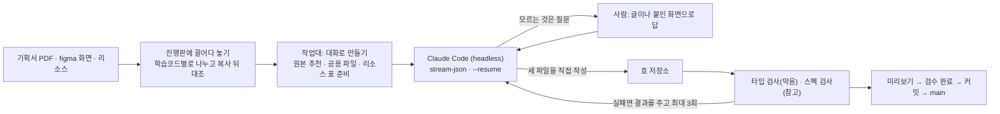

# Activity Forge — 학습 액티비티 양산 데스크톱 앱

> 에듀테크 학습 콘텐츠의 **반복 제작(「양산」)을 자동화**한 Windows 데스크톱 앱과 생성기입니다.
> 기획서(PDF) · figma 화면 · 디자인 리소스를 넣으면, **AI(Claude Code)가 액티비티 코드를 쓰고 도구와 스펙이 검산**합니다.
> 1인 개발 — 기획 · 설계 · 구현 · 배포 · 사내 보급까지 맡았습니다.

**English summary** — An Electron + TypeScript desktop tool that automates mass production of interactive learning
activities. Designers' figma screens, planning PDFs and assets go in; a headless Claude Code agent writes the activity
code into the target repo; the tool verifies it against 120+ JSON module specs, type-checks it, retries with feedback,
and walks the human through review, commit and release. Built solo, from design to in-house rollout.

> **공개본 안내** — 실제 업무에 쓰는 저장소에서 회사 자료(호별 배치표, 사내 문서, 측정 도구 대부분)와
> 내부 주소 · 이름을 덜어 낸 사본입니다. 모듈 스펙(`forge/_spec/`)은 들어 있습니다. 배치표와 호 저장소가 없어 실행하면 빈 결과가 나옵니다.

---

## 왜 만들었나

학습 콘텐츠는 **학습코드(액티비티) 단위**로 만들어지고, 매 호마다 수십 개가 새로 나옵니다.
액티비티마다 **모듈(게임 틀) 코드는 같고** 바뀌는 것은 세 파일뿐입니다.

| 파일 | 내용 |
|---|---|
| `GameData.ts` | 이닝 · 정답 · 좌표 · 대사 같은 값 |
| `AssetTable.ts` | 그림 · 소리 · 애니메이션 목록 |
| `Activity.ts` | 모듈을 불러 시작하는 입구 |

이 세 파일을 사람이 기획서와 figma 를 보며 손으로 옮겨 적었습니다. 좌표를 재고, 파일 이름을 맞추고,
앞 호에서 쓴 소리를 다시 찾아 넣는 일이 대부분이었습니다. **그 손 작업을 없애는 것**이 목표였습니다.

## 무엇을 하나



| 화면 | 기능 |
|---|---|
| **진행판** | 호 · 과목별로 학습코드마다 상태(입력 필요 · 생성 중 · 답변 필요 · 검수 대기 · 개발 완료)와 다음 할 일. 「지금 바로 할 수 있는 학습코드」를 완료에 가까운 순서로 모아 줌 |
| **끌어다 놓기** | 기획서 · figma 화면 · 리소스 폴더를 통째로 놓으면 학습코드별로 나눠 넣고, 복사한 뒤 원본과 대조. 못 가르는 파일은 사람에게 물음 |
| **작업대 · 대화로 만들기** | 원본(같은 모듈 완성본)을 골라 주고 Claude 가 세 파일을 씀. 질문은 오른쪽 대화 칸에 뜨고, 글이나 Ctrl+V 화면으로 답하면 같은 대화로 이어 감 |
| **받을 리소스 창** | figma 옆에 띄워 두는 작은 창. 앞 학습코드의 그림 크기 · 소리를 보여 주고, 들어온 파일의 이름과 크기를 체크 |
| **검수 완료 · 커밋** | 개발 완료 표시 → 그 학습코드만 커밋 · 푸시 → fast-forward 가 될 때만 main 에 올림 |
| **관리** | 호 저장소들의 커밋 안 한 파일 · 뒤처짐, 받을 리소스, 완성본 전체 스펙 검사, 팀별 완료 현황 |
| **업데이트 · 초기 설정** | 앱 새 버전과 자료를 한 단추로 받음. 처음 켜면 작업 폴더 하나만 고르면 필요한 저장소를 받고 git · Claude Code · poppler 를 확인 |

## 기술 스택

- **앱**: Electron 44 · electron-vite 5 · Vite 7 · React 19 · TypeScript 7 (yarn)
- **생성기(forge)**: Node · ts-node · TypeScript — **외부 의존성은 `typescript` 하나**. 로그인도 DB 도 없이 앱이 그대로 불러 씀
- **AI**: Claude Code CLI 를 headless 로(`claude -p --output-format stream-json`, `--resume`)
- **그 밖**: PowerShell(ACL · 레지스트리), git(셸 없이 호출), poppler(기획서 PDF 렌더링, 실행 파일에 동봉)

## 설계에서 신경 쓴 것

### 1. AI 는 만들고, 도구가 검산한다
- 모듈마다 **JSON 스펙(120여 장)** 을 둡니다 — 항목의 꼴, 반드시 있어야 할 리소스 이름(`fixedAlias`), 항목 사이 관계.
- AI 가 쓴 결과는 **타입 검사로 막고**, 실패하면 오류를 그대로 돌려주며 **최대 3번** 다시 맡깁니다.
- 스펙 자체도 검사합니다 — `check:spec`(꼴 · 왕복 · import · 값을 담는지), `check:repro`(완성본을 스펙으로 다시 만들어 글자까지 같은지),
  `check:odd`(같은 모듈 완성본끼리 혼자만 다른 값). 개발 완료 액티비티 **857개** 전체를 스펙 검사에 다시 넣는 점검도 있습니다(2026-10-08: 통과 802, 결함 9, 스펙 없는 모듈 46). 걸린 9개는 모두 완성본이 AssetTable 에 없는 리소스 이름을 부르던 결함이었습니다.
- **figma 화면이 기본 입력**입니다. 화면이 없으면 AI 를 아예 부르지 않고 어디를 찍어 오라고 알려 줍니다(비용과 헛수고 방지).

### 2. 헤드리스 AI 를 안전하게 붙이기
- 쓰기는 **작업 폴더 안만**, 셸 없음 — 허용 규칙을 인자로 묶어 둡니다(`aisession.ts`, `aisessionio.ts`).
- 부르기 직전 **금액 상한**을 보고, 계정 한도 오류는 사람 말로 바꿔 보여 줍니다(`aitally.ts`).
- 진행은 한 줄씩 화면에 흘려 보이고, 「멈추기」는 AI 차례 사이(검사 중)에도 먹습니다. 같은 학습코드는 한 판만 돕니다.
- **녹음 · 재생(`tape.ts`)** — AI 의 물음과 답을 녹음해 두고 AI 없이 파이프라인만 다시 돌립니다.
  AI 가 매번 다르게 답해도 **도구가 망가졌는지만** 따로 잴 수 있게 했습니다.

### 3. 계층으로 나눈 메인 프로세스
- `ipc/`(얇은 어댑터, 로직 없음) · `services/`(도메인, **Electron 을 import 하지 않음** — Node 로 단독 실행 · 확인) · `lib/`(범용).
- IPC 채널 이름은 `shared/ipc.ts` 상수 한 곳 — main 과 preload 가 갈라지면 컴파일에서 걸립니다.
- 렌더러 입력 검증(신뢰 경계)은 IPC 진입점 한 곳에서만. 오류는 throw 대신 결과 객체로 돌려 화면이 멈추지 않게.
- `contextIsolation` · `sandbox` 유지, `nodeIntegration` 미사용.
- 생성기(forge)는 **`runtime.ts` 한 곳으로만** 불러 씁니다. forge 는 import 순간 환경변수로 뿌리 폴더를 정하므로,
  환경변수를 심고 동적 import 한 뒤 **심은 값이 먹었는지까지 확인**합니다(안 그러면 조용히 빈 결과).

### 4. 스스로 업데이트되는 사내 배포
- 빌드한 `out/` 을 원격의 별도 가지(`app-dist`)에 커밋 하나로 올리고, 앱은 그것을 받아 사용자 데이터 폴더에 풉니다.
- 시작점(`boot.ts`)이 **실행 파일에 든 판과 받은 판 중 늦게 빌드한 쪽**을 열고, 깨졌으면 든 것으로 돌아갑니다.
- 자료(스펙 · 배치표)는 `git pull --ff-only`, 로컬에서 고친 파일이 있으면 받지 않습니다.
- 빌드 결과 검사(`check:build`) — 번들에 함수가 두 벌 묶이거나 대입이 빠진 채로는 올라가지 않게.

### 5. figma 화면을 읽는 도구
- 붙여넣은 화면이 **1x 크기인지 판정**하고, 같은 화면을 두 번 붙이면 받지 않습니다.
- 리소스 그림을 figma 화면에서 **찾아 좌표를 뽑는** 이미지 매칭(`gen/imgfind`, `gen/placefind`) — 겹치는 영역을 칠해 가리고 찾는 등.
- 원본 후보마다 장면 그림을 화면에서 찾아, 원본을 잘못 고른 것을 생성 전에 묻는 기능도 만들었습니다.

### 6. Windows 현실
- 쓰기 권한은 `fs.access(W_OK)` 가 ACL 을 안 보므로 **PowerShell 로 ACL 을 읽어 병합 · 계산**합니다.
- 한글 `.ps1` 은 UTF-8 BOM, `.bat` 주석은 ASCII — 인코딩 때문에 경로가 조용히 깨진 경험에서 나온 규칙.
- 지우기는 **휴지통으로만**, 옮기기 · 지우기 전에는 양쪽 파일 수와 용량을 대조.
- 경로 대소문자가 실제와 다르면 메인 코드가 두 벌 묶이는 문제 — 빌드 경로를 `realpathSync.native` 로.

## 일하는 방식 — 「타입 체크는 확인이 아니다」

- 화면은 띄워서 보고, 숫자는 OS 도구(`du`, `find | wc -l`)로 대조하고, 권한은 진짜 폴더로 확인했습니다.
- 밟은 함정을 **99개** 기록하고(예: 「Electron 은 셸을 죽여도 안 죽는다」, 「같은 뜻의 답이 두 꼴로 오면 규칙을 한 꼴에만 걸었을 때 조용히 빠진다」,
  「개수를 세는 검사는 자리를 안 본다 — 정답이 틀려도 통과한다」), 새 기능을 만들 때 먼저 읽게 했습니다.
- 문서의 파일 목록이 디스크와 맞는지 검사하는 스크립트(`check:docs`) — 구조도가 몇 달씩 낡는 것을 막으려고.
- AI(Claude Code)를 **페어 프로그래머**로 썼습니다. 작업 규칙 문서와 메모리로 「계층 먼저 정하기, 같은 것 두 번 쓰지 않기,
  모르는 것은 null 로 두고 숨기지 않기, 되돌릴 길 남기기」를 매 작업 지키게 했습니다.
- 앱 안 「기능」 화면에 기능 목록과 **「자동화하기 어려운 것」**(학습코드마다 사정이 달라 기계가 혼자 정하지 못하는 것)을 적어 두었습니다.

## 규모

| | |
|---|---|
| 앱 | TypeScript 약 27,600줄 · 272개 파일 (메인 서비스 147 · IPC 14 · 화면 컴포넌트 53) |
| 생성기 | TypeScript 약 12,800줄 · 116개 파일 |
| 모듈 스펙 | 123장 (`forge/_spec/`) |
| 이 저장소 기록 | 2026-09-11 ~ , 커밋 188개 |

## 폴더

```
electron_app/            데스크톱 앱
  src/main/              메인 프로세스 — boot · window · ipc/ · services/ · lib/
  src/preload/           contextBridge 로 허용한 API 만
  src/renderer/src/      React 화면 — 진행판 · 작업대 · 관리 · 기능 · 받을 리소스 창
  src/shared/            메인과 화면이 같이 쓰는 타입 · IPC 채널 상수
  scripts/               릴리스 · 빌드 검사 · 문서 검사 · poppler 동봉
forge/                   생성기 — 스펙 검사 · 생성 · figma 화면 그림 찾기 · 브라우저 UI
  src/tool/              check:spec · check:repro · check:odd
figma-plugin/            figma 안에서 이닝 차례 · 낱말을 뽑는 플러그인 (REST API 가 바이트로 한도를 매겨 만들었으나, 조직 정책으로 막혀 접어 둠)
```

## 실행

```bash
cd electron_app
yarn install
yarn dev          # 감시 모드로 앱 실행
yarn typecheck    # main · preload · renderer 타입 검사
yarn build
```

Claude Code 안에서 Electron 을 띄울 때는 상속된 `ELECTRON_RUN_AS_NODE` 를 먼저 지워야 합니다.
